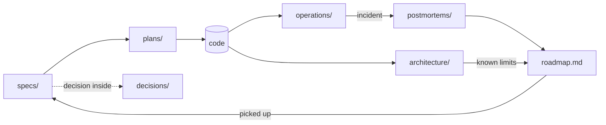

# docs

Start with the architecture overview, then the roadmap.

| Folder / file | What's in it | Changes when |
|---|---|---|
| [`architecture/`](architecture/overview.md) | Diagrams of the system **as it runs today** — [overview](architecture/overview.md), [url-shortener](architecture/url-shortener.md), [deliveroo](architecture/deliveroo.md), [observability](architecture/observability.md) | the system changes (same commit) |
| [`roadmap.md`](roadmap.md) | What to improve next, prioritized, each with evidence and a done-when | an item is found or finished |
| [`decisions/`](decisions/README.md) | ADRs — one decision each, numbered, never edited after acceptance | a decision is made or superseded |
| [`specs/`](specs/) | Design docs, written before building | a feature is designed |
| [`plans/`](plans/) | Step-by-step implementation plans for a spec | a spec is about to be built |
| [`operations/`](operations/) | [SLOs](operations/slos.md), [runbook](operations/runbook.md), [postmortems](operations/postmortems/) | an SLO, a procedure, or an incident |
| [`study/`](study/) | The learning plan: [syllabus](study/learning-plan.md), [week-by-week](study/plan-detailed.md), [acceptance criteria](study/acceptance.md), [progress](study/progress.md), [notes](study/notes.md), [exercises](study/exercises/) | studying — mostly written by `/learn-sd` |

## How they connect

A spec proposes; a plan executes it; the architecture docs describe what
resulted. Operating it produces SLO data and postmortems, which — together with
the known limits in the architecture docs — feed the roadmap. A roadmap item big
enough to design becomes the next spec.

## Where to put a new doc

See the table in the root [`CLAUDE.md`](../CLAUDE.md#where-docs-go).
