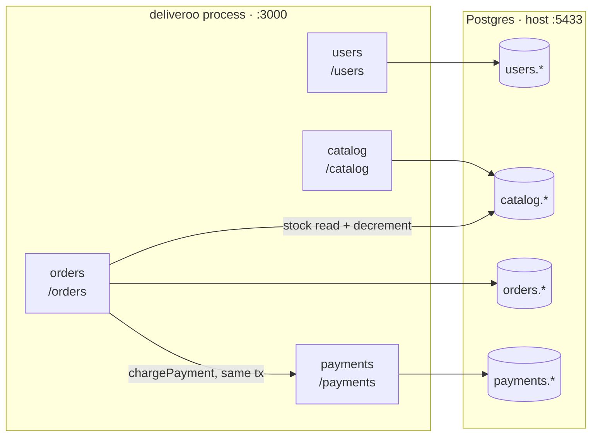
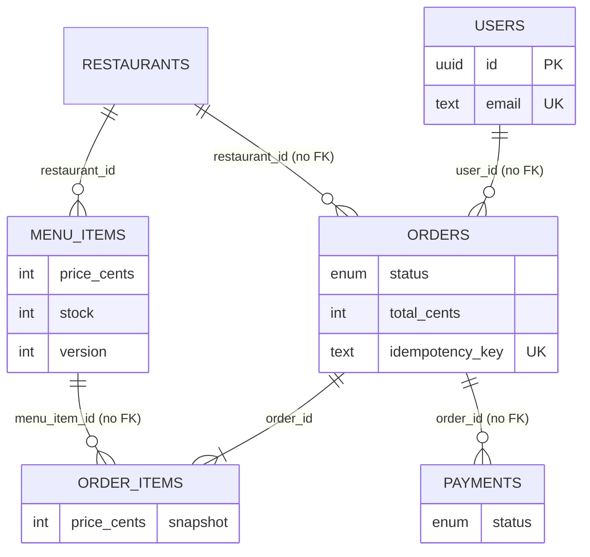
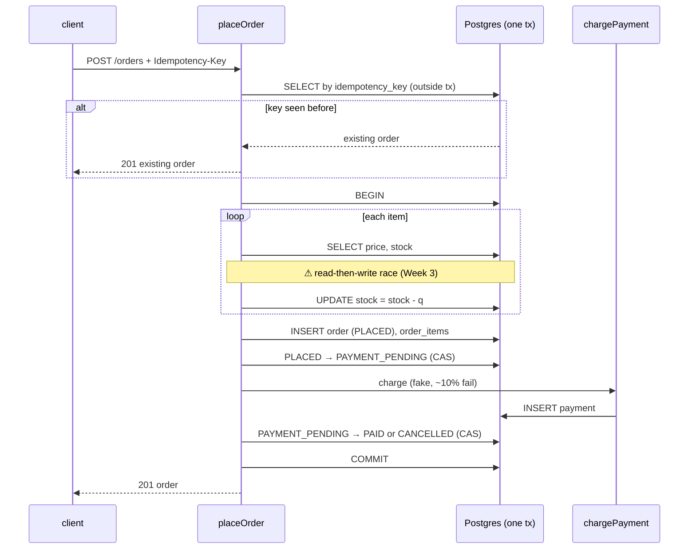
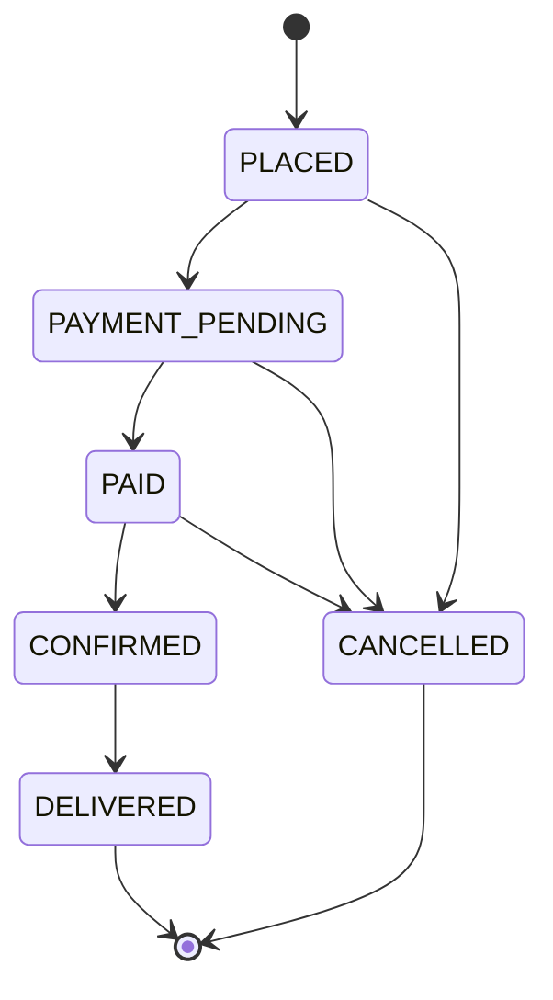

# deliveroo

`apps/deliveroo-node/` — the long-arc build: a modular monolith today, split
into services in Phases 2–3. Fastify + TypeScript + Postgres through the raw
`pg` driver. Migrations are plain SQL in `migrations/`; there is no ORM.

**Not instrumented.** No OTel preload, so nothing from deliveroo reaches the
Collector. It gets one once the saga chain exists and a distributed trace is
worth collecting.

## Modules

Each module owns one Postgres **schema**, registers under its own URL prefix,
and never reads another module's tables. Cross-module calls go through the
other module's `service.ts`. That discipline is the seam Phase 2 will cut along.

**The two arrows out of `orders` break the rule on purpose.** `placeOrder`
touches `catalog.menu_items` directly for stock, and calls payments **inside the
order transaction**. Both are noted in the code as couplings the saga will
remove.

## Routes

| Method | Path | Module |
|---|---|---|
| POST / GET | `/users`, `/users/:id` | users |
| POST / GET | `/catalog/restaurants` | catalog |
| GET | `/catalog/restaurants/:id/items` | catalog |
| POST | `/orders` (header `Idempotency-Key`) | orders |
| GET | `/orders/:id` | orders |
| GET | `/payments/order/:orderId` | payments, read-only |
| GET | `/health` | `SELECT 1` |

Payments has no write route: `chargePayment` takes the order's transaction
handle, and an endpoint that charges an arbitrary order id would be a hole.

## Data model

Foreign keys stop at schema boundaries — modules own their data. Inside a
module they're real (`menu_items → restaurants`, `order_items → orders`).
`order_items.price_cents` is a snapshot at order time and is never joined back
to the catalog.

## Placing an order — one transaction

Two known gaps, both deliberate and both on the [roadmap](../roadmap.md):

- **Stock race.** Two concurrent orders can both read `stock = 1` and both
  succeed. Fixing it three ways (pessimistic lock, optimistic version guard,
  `SERIALIZABLE` + retry) is the Week 3 lab.
- **Idempotency check-then-act.** The key lookup runs outside the transaction,
  so two simultaneous retries can both miss it. The `UNIQUE` constraint on
  `idempotency_key` is what actually prevents a duplicate — the second insert
  fails instead of returning the first order.

## Order state machine

Every status write goes through `transitionOrder`, which checks the edge against
`TRANSITIONS` **and** writes with `WHERE id = $2 AND status = $3`, so a row
someone else already moved is not silently overwritten.

**Only three edges are reachable today:** `PLACED → PAYMENT_PENDING` and
`PAYMENT_PENDING → PAID | CANCELLED`, all inside `placeOrder`. No route
confirms, delivers, or cancels a paid order yet.
