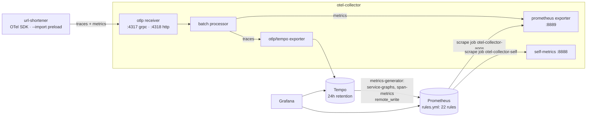
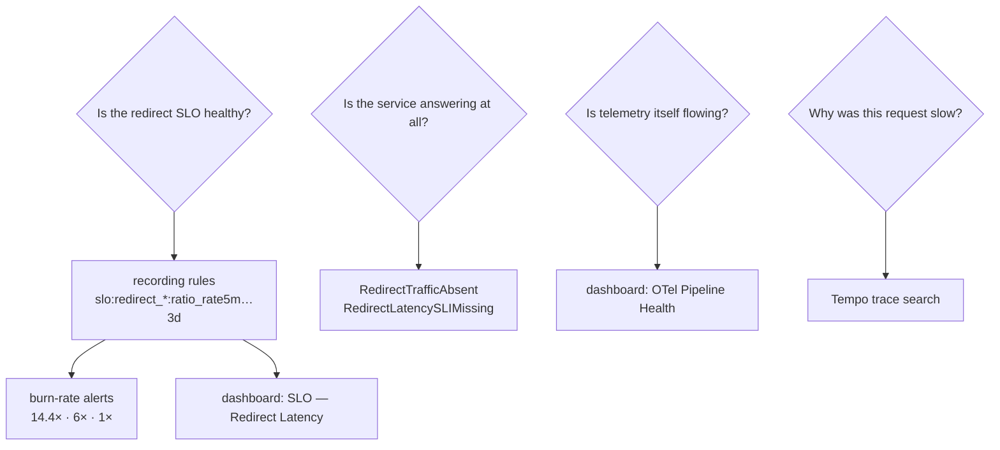

# observability

`infra/observability/` — OpenTelemetry Collector, Prometheus, Tempo, Grafana.
Apps export over OTLP; nothing is scraped from the apps directly. Operating
rules and ports: [`infra/observability/CLAUDE.md`](../../infra/observability/CLAUDE.md).
The SLO definitions themselves: [`../operations/slos.md`](../operations/slos.md).

## Pipeline

Why this shape and not a `/metrics` route per app:
[ADR 0002](../decisions/0002-otel-sdk-otlp-collector.md). Metrics leave the app
over OTLP only, so there is one source of truth.

## What the app emits

| Signal | Name | Labels |
|---|---|---|
| histogram | `http_request_duration_seconds` | `method`, `route` (matched template, never the raw path), `status` |
| counter | `cache_hits_total`, `cache_misses_total` | — |
| counter | `id_blocks_total` | — |
| traces | HTTP, MongoDB, ioredis spans | via auto-instrumentation |

Latency buckets are `[0.005, 0.01, 0.025, 0.05, 0.1, 0.25, 0.5, 1]` seconds.
**`0.05` is load-bearing** — it is the latency SLO threshold, and a test asserts
it stays. Without a bucket edge exactly there the SLI can only be interpolated.

`resource_to_telemetry_conversion` is **off**. On, it stamped 17 resource labels
(including `process_pid` and the full argv) onto every series.

## Where each question gets answered

## Alerts

| Alert | SLO | Severity |
|---|---|---|
| `RedirectLatencyBudgetBurnCritical` / `High` / `Slow` | latency | critical / warning / ticket |
| `RedirectLatencySLIMissing` | latency guard | warning |
| `RedirectAvailabilityBudgetBurnCritical` / `High` / `Slow` | availability | critical / warning / ticket |
| `RedirectTrafficAbsent` | availability guard | critical |

All alerts are evaluated by Prometheus. **There is no Alertmanager**, so a firing
alert shows up in the Prometheus and Grafana UIs and pages nobody.

## Dashboards

| Dashboard | Panels | Shows |
|---|---|---|
| SLO — Redirect Latency | 7 | SLI, budget left, burn rate, p99 (dashboard-only), good vs total |
| OTel Pipeline Health | 8 | spans/metrics accepted vs sent vs dropped, per Collector stage |
| Broker Spike — Kafka vs RabbitMQ | 7 | only meaningful while `infra/broker-spike` is up |

**No availability dashboard yet** — the SLO has alerts but no panels.
