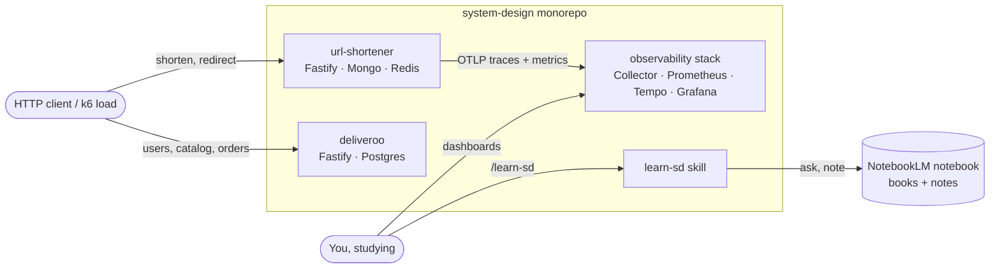
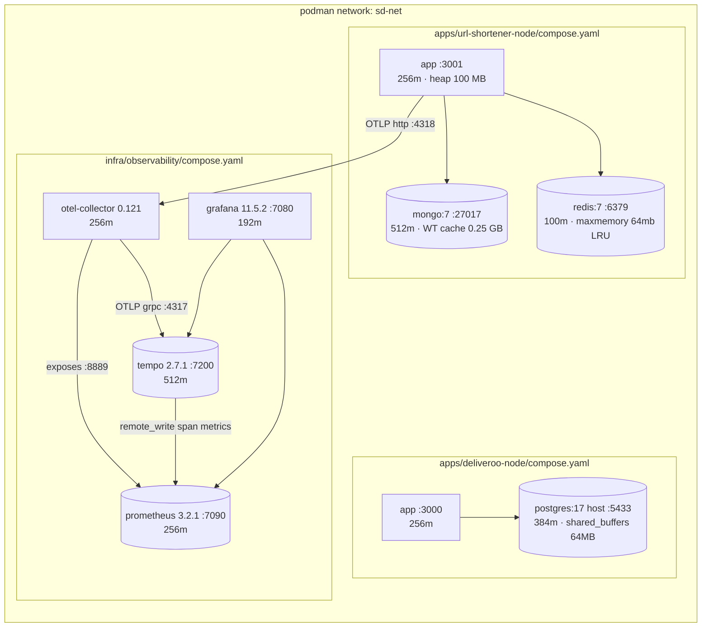

# Architecture overview

The system **as it runs today** (2026-09-28). When a change alters any box or
arrow below, update this file in the same commit. What should change next lives
in [`../roadmap.md`](../roadmap.md), not here.

Two services, one telemetry stack, all in containers on one podman network
(`sd-net`). Everything runs on one laptop VM; no service is deployed anywhere.

## Context

**deliveroo sends no telemetry.** It has no OTel preload yet; see
[roadmap](../roadmap.md). Only url-shortener appears in Grafana.

## Containers

Arrows point from the caller to the thing it calls, except `col → prom`:
Prometheus **scrapes** the Collector's `:8889` endpoint (pull), it is not pushed.

## Host ports

| Port | What | Why this number |
|---|---|---|
| 3001 | url-shortener | app default |
| 3000 | deliveroo | app default |
| 27017 / 6379 | Mongo / Redis | upstream defaults |
| **5433** | deliveroo Postgres | 5432 is taken by a Homebrew Postgres that silently shadowed the container once |
| 7080 7090 7200 | Grafana, Prometheus, Tempo | the 7xxx block — [ADR 0004](../decisions/0004-host-ports-7xxx-block.md) |
| 7317 / 7318 | OTLP gRPC / HTTP | 7 + upstream 4317 / 4318 |
| 7889 7133 | Collector app-metrics / health | 7 + upstream 8889 / 13133 |

Containers talk to each other on **upstream** ports (`otel-collector:4318`); the
7xxx numbers exist only on the host.

## Memory budget

Every container has a `mem_limit`, measured rather than guessed —
[ADR 0006](../decisions/0006-containerise-apps-per-area-compose.md).

| Container | Limit | Why that much |
|---|---|---|
| url-shortener app | 256m + `--max-old-space-size=100` | RSS runs ~1.8× heap; 50 MB heap dies at startup |
| mongo | 512m + `--wiredTigerCacheSizeGB 0.25` | WiredTiger sizes from **host** RAM; at 100m it was OOM-killed by the test suite |
| redis | 100m, `maxmemory 64mb` | eviction, not OOM, when full |
| postgres | 384m | `max_connections=50` keeps per-connection memory bounded |
| tempo | 512m | raised after an OOM kill |
| collector, prometheus | 256m each | |
| grafana | 192m | |

**Total ceiling ≈ 2.6 GB.** Idle usage is far below that; the limits are there
so a runaway process gets killed instead of starving everything else.

## Per-service detail

- [url-shortener](url-shortener.md) — request paths, cache, id allocation, click flush
- [deliveroo](deliveroo.md) — modules, order transaction, state machine
- [observability](observability.md) — telemetry pipeline, SLOs, alerts, dashboards
