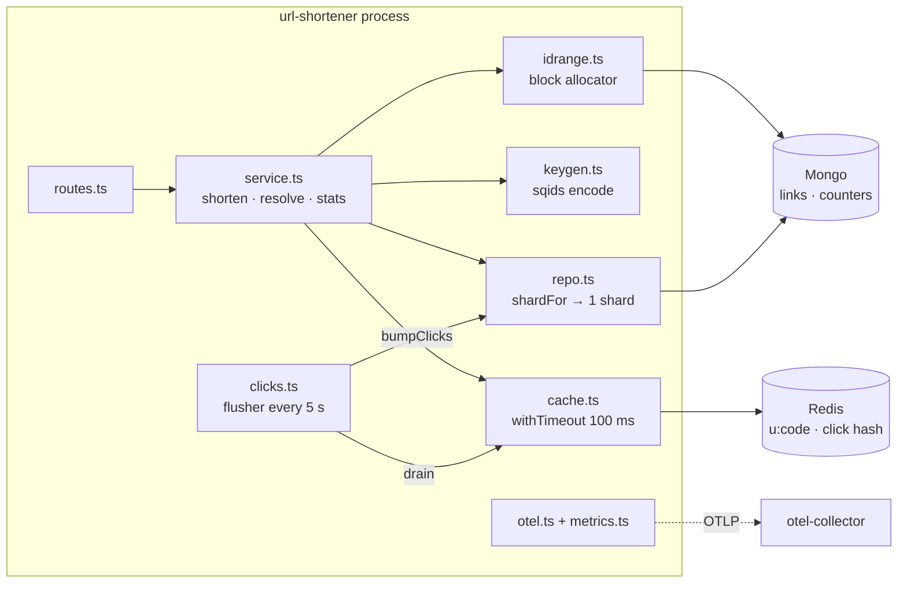
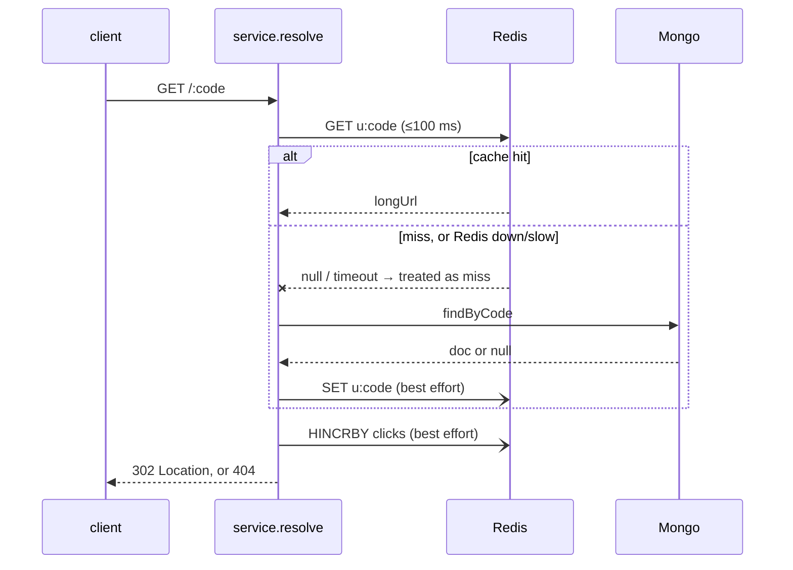

# url-shortener

`apps/url-shortener-node/` — Fastify + TypeScript, MongoDB for links, Redis for
the redirect cache and click counters. The reference service for the
observability build, and deliberately over-built for its load
([ADR 0001](../decisions/0001-url-shortener-mongo-and-redis.md)).

## Routes

| Method | Path | Does |
|---|---|---|
| POST | `/api/v1/urls` | shorten → `201 { code }` |
| GET | `/api/v1/urls/:code` | stats (the stored document) |
| GET | `/:code` | **redirect** → `302`, or `404` for an unknown code |
| GET | `/health` | pings Mongo + Redis → `200` or `503` |

The redirect route carries both SLOs (latency and availability).

## Components

## Redirect — the hot path

Every Redis call is wrapped in `withTimeout(100 ms)` and a `try/catch`. **The
cache is an optimisation, and an optimisation is never worth waiting on or
failing for.** Three bugs in exactly this path were found by the
[game-day](../operations/postmortems/2026-08-30-redis-gameday.md).

## Write path

1. `idrange` hands out the next id from an in-memory block. When the block runs
   out it claims the next `ID_BLOCK_SIZE` ids with one atomic `$inc` on the
   `counters` collection. One Mongo write per block, not per link.
2. `keygen` encodes the id with **sqids**: reversible, non-sequential, URL-safe.
3. `repo.insertLink` writes the document. `short_code` has a unique index; TTL
   index on `expires_at`.
4. Warm the cache — best effort, a failure is logged and ignored.

**Coupling to know about:** codes are derived from the counter. Reset
`counters` without resetting `links` and the app re-issues codes that already
exist (`E11000`). Tests run against `shorturl_test` behind a guard for this
reason — [ADR 0005](../decisions/0005-tests-on-throwaway-stores.md).

## Click counting

Redirects `HINCRBY` a Redis hash. Every 5 s the flusher atomically reads and
clears it, then `$inc`s the totals into Mongo. A crash between those two steps
**loses** the drained counts — accepted, because click counts are approximate.
This is a dual write that is allowed to fail.

## Seams built but not used

| Seam | Today | Trigger point to use it |
|---|---|---|
| `shardFor(code)` | `SHARD_COUNT = 1` | single Mongo can't hold the data or the write rate |
| block id allocation | 1000 ids per block (`ID_BLOCK_SIZE`) | thousands of write QPS |
| Redis cache | always on | a single DB can't serve the read QPS |

At the real load (~58 read QPS) one database would do. Each seam names the
point where it starts to pay for itself.
