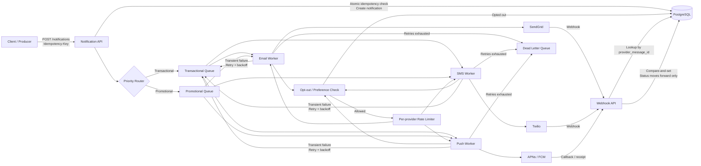

# Notification system — guided attempt

- **Date:** 2026-09-30 → 2026-10-21 · guided, nhiều buổi (không bấm giờ)
- **Format:** guided — one section at a time, feedback between sections (chosen 2026-09-30).
  Fill every heading, even with one line —
  an empty section scores zero, a thin one scores something.

---

## 1. Requirements · ~5 min

**Functional** — what the system does (verbs):
- User able to configs CRUD the notification
- User able to select which channel to create
- The system must store notification preferences per user and per channel.
- The system must handle retry logics
- Channel should act independently
- Support all channels 
- Support error messages (DLQ)
- Save logs, store audit

**Non-functional** — with numbers where you can:
- Scale: Handle 10M notifications/day initially.
- Latency: P95 below 3s, p99 below 10s
- Availability / durability: 99.99% API avail
- Consistency: at-least-once delivery

**Out of scope** — what you're deliberately not designing:
- Managing third-party providers themselves.
- Guaranteeing final delivery after provider acceptance.
- Marketing campaign creation and audience segmentation.
- Client-side notification UI/UX.
- Channels other than Push, SMS, and Email.

## 2. Capacity estimates · ~5 min

Show the arithmetic, not just the answer. Round hard.

Average QPS	100M / 86,400 sec	~1.2K/sec
Peak QPS	1.2K × 10 peak factor	~12K/sec
Storage / year	100M/day × 365 × 1 KB	~40 TB/year
Bandwidth	12K/sec × 1 KB × 8	~100 Mbps peak

**What the numbers tell you** (one line — does anything here force a design choice?):
~12K requests/sec is easy to scale horizontally, but ~40 TB/year and bursty third-party rate limits push us toward asynchronous processing with durable queues, partitioned workers, and retention/archival policies.

## 3. API · ~3 min

External and internal interfaces. Signature + one-line purpose.

```
POST /v1/notifications
    → 202 Accepted
    # Create a notification request and enqueue it for delivery.

GET /v1/notifications/{notificationId}
    → NotificationStatus
    # Get overall and per-channel delivery status.

PUT /v1/users/{userId}/preferences
    → 200 OK
    # Update notification preferences / opt-outs per channel.

GET /v1/users/{userId}/preferences
    → NotificationPreferences
    # Read current channel preferences before sending.

POST /v1/providers/{provider}/webhooks
    → 200 OK
    # Receive delivery, bounce, failure, and unsubscribe callbacks from providers.
```
```
publish(notification)
    → void
    # Put the notification onto the appropriate transactional/promotional queue.

send(channel, notification)
    → SendResult
    # Channel worker sends through APNs, FCM, Twilio, or SendGrid.

getPreferences(userId)
    → NotificationPreferences
    # Check latest opt-out state before provider submission.

markStatus(notificationId, channel, status)
    → void
    # Persist delivery state and retry/failure information.
```

```
GET /v1/me/notification-preferences
    → NotificationPreferences
    # End user reads their current Push, SMS, and Email preferences.

PUT /v1/me/notification-preferences
    → NotificationPreferences
    # End user updates preferences for one or more channels.

POST /v1/me/notification-preferences/{channel}/opt-out
    → 200 OK
    # End user disables notifications for a specific channel.

POST /v1/me/notification-preferences/{channel}/opt-in
    → 200 OK
    # End user re-enables notifications for a specific channel.
```

## 4. Data model · ~3 min

```

| Table | Key / index | Main fields | Important behavior |
|---|---|---|---|
| `notifications` | PK: `notification_id` | `user_id`, `type`, `priority`, `template_id`, `payload`, `created_at` | Stores one logical notification |
| `notification_deliveries` | PK: `(notification_id, channel)`; UNIQUE/INDEX on `provider_message_id` | `provider`, `status`, `attempt_count`, `provider_message_id`, `last_error`, `next_retry_at`, `updated_at` | Webhooks look up by `provider_message_id`; status updates only move forward |
| `user_notification_preferences` | PK: `(user_id, channel)` | `enabled`, `updated_at` | Stores per-channel opt-in / opt-out |
| `push_devices` | PK: `device_id`; INDEX on `user_id` | `platform`, `provider`, `device_token`, `status`, `last_seen_at` | Supports multiple APNs / FCM devices per user |
| `notification_idempotency` | UNIQUE: `(client_id, idempotency_key)` | `notification_id`, `created_at`, `expires_at` | Use `INSERT ... ON CONFLICT DO NOTHING` to guarantee atomic insert-if-absent |
| **Retry handling** | Queue-based delayed retry | `next_retry_at` retained for audit/observability | Avoid polling PostgreSQL for all due retries |
| **Storage choice** | PostgreSQL initially | — | Good for strong consistency, transactions, unique constraints, and simple operational model; partition large notification tables by time and archive old data as scale grows |

For idempotency:

```sql
INSERT INTO notification_idempotency (
    client_id,
    idempotency_key,
    notification_id,
    created_at,
    expires_at
)
VALUES (...)
ON CONFLICT (client_id, idempotency_key)
DO NOTHING;
```

That directly fixes the concurrent retry race.

And for scale, I’d say:

> Start with PostgreSQL because it gives us strong consistency and simple atomic constraints for opt-outs and idempotency. Partition high-volume notification tables by date, keep hot retention short, and archive old delivery history to cheaper storage as volume approaches 100M/day.

**Storage choice and why** (one line): PostgreSQL — cần strong consistency và `UNIQUE` constraint nguyên tử cho idempotency và opt-out; ở 10× thì shard theo `notification_id` (mục 7).

## 5. High-level design · ~9 min


**Walk one request through it** (3–5 numbered steps):
1.

## 6. Deep dive · ~15 min

Pick the 2–3 parts that are genuinely hardest. For each: the problem, your
answer, and what goes wrong with the obvious answer.

### 6a. Retry mà không gửi trùng email

**Problem:** Worker gửi email qua SendGrid thành công rồi crash trước khi ghi trạng thái và ack. Worker khác nhận lại job (chưa ack, trạng thái chưa cập nhật) và gửi lần nữa → duplicate delivery: khách nhận 2 email xác nhận cho cùng một đơn.

**Answer:** Dedupe key `(notification_id, channel)` (bảng `notification_deliveries`). Thứ tự **send → mark**: gửi qua provider rồi mới ghi `status = sent`, sau đó mới ack. Crash giữa send và mark → retry gửi lại → **at-least-once**. Chọn vì với email xác nhận đơn, 2 email tốt hơn không nhận email nào. (Mark → send sẽ là at-most-once: crash ở giữa thì khách không bao giờ nhận.)

**Why the obvious answer fails:** Dedupe theo queue message ID không bắt được duplicate: cùng một business event (order 42) có thể bị publish nhiều lần, hoặc replay từ DLQ, và mỗi lần lại có một message ID mới. Message ID là ID của từng lần giao, không phải của event. Phải dedupe theo business idempotency key `(notification_id, channel)`.

### 6b. Promotional blast làm nghẽn transactional

**Problem:** Dù đã tách 2 queue, email OTP/xác nhận vẫn bị delay, vì transactional và promotional vẫn dùng chung SendGrid rate limit (N email/giây). Promotional blast chiếm hết quota nên transactional phải chờ hoặc bị 429. Queue tách riêng, nhưng **tài nguyên phía sau vẫn dùng chung**.

**Answer:** Rate limiter ưu tiên **có cho mượn**: transactional luôn đi trước với sàn bảo đảm (ví dụ 80% của N); phần transactional không dùng thì promotional được mượn, OTP tăng vọt thì promotional nhường ngay. Thêm: tách subaccount/IP riêng cho promotional để email spam-complaint của marketing không kéo uy tín IP gửi OTP. Ước tính với N = 500/s, transactional dùng thực tế khoảng 50/s, 5M promotional:
- chia cứng 80/20 → 100/s → 50,000 s ≈ **13.9h** (blast lúc 9h sáng xong lúc 23h)
- cho mượn → 450/s → 11,111 s ≈ **3.1h**

**Why the obvious answer fails:** "Tách queue transactional/promotional là đủ" — không đủ, vì cả hai vẫn đổ vào cùng một rate limit của provider; tách queue mà tài nguyên phía sau dùng chung thì blast vẫn chiếm hết quota. Còn chia cứng 80/20 thì bảo vệ được OTP nhưng lãng phí: promotional chậm 4.5× vì quota bỏ trống.

### 6c. (optional)

One sequence **or** state diagram belongs here, for whichever part is hardest.

## 7. Bottlenecks & trade-offs · ~5 min

| Bottleneck / risk | What happens | Mitigation | Cost of the mitigation |
|---|---|---|---|
| Worker crash giữa gửi email và ghi `sent` | Retry gửi lại → khách nhận 2 email | Thứ tự send → mark + dedupe key `(notification_id, channel)` | Vẫn có thể gửi trùng (hiếm, chỉ khi crash đúng khe đó) → **at-least-once**, không phải exactly-once |
| Promotional blast dùng chung rate limit SendGrid | OTP chậm / 429 → khách không đăng nhập được | Rate limiter ưu tiên transactional, cho mượn quota; subaccount/IP riêng cho promotional | Promotional chậm khi OTP tăng vọt; phải tự viết và vận hành rate limiter có priority |
| Promotional gửi trùng | Khách bực → unsubscribe / báo spam → uy tín IP gửi giảm | Promotional dùng mark → send | Đôi khi mất email khuyến mãi → **at-most-once** (chấp nhận được: mất 1 quảng cáo ít hại hơn gửi 2 lần) |

**What you'd change at 10× the load:** Peak 12K/s → 120K/s: PostgreSQL hỏng đầu tiên (mỗi lần gửi ghi ≥1 dòng `notification_deliveries` + dedupe, một instance chỉ khoảng 10K ghi/s). Đổi sang **shard PostgreSQL theo `notification_id`**: dedupe key `(notification_id, channel)` luôn nằm cùng shard nên `UNIQUE` vẫn chặn trùng. Chấp nhận: vận hành nhiều DB, query xuyên shard (mọi notification của một user) phải fan-out hoặc cần index phụ. Provider cũng chạm trần ở tốc độ này → nhiều provider, rate limiter (6b) chia tải.

---

## Self-check before saying "done" (30 seconds)

- [ ] Every section has something in it
- [ ] Guarantees are **named** (at-most-once, at-least-once, exactly-once…), not described
- [ ] Every "retry" says what stops it retrying forever
- [ ] Every trade-off names what you gave up
